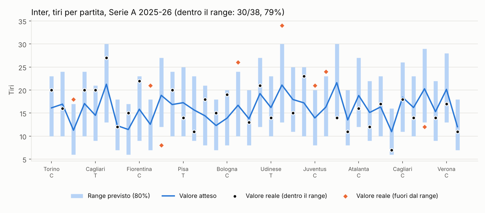

# Football Stats Forecast

Previsione delle statistiche di una partita di calcio (gol, tiri, tiri in porta, falli, corner, cartellini) **con un intervallo di previsione**, non solo con un numero.

```
$ python -m footstats predict Inter Roma

Inter – Roma   (range al 80%, dati fino al 2026-05-24)

  Inter
    Gol            atteso   1.7    range  0–3    (probabilità 91%)
    Tiri           atteso  14.4    range  8–21   (probabilità 86%)
    Tiri in porta  atteso   5.1    range  2–8    (probabilità 87%)
    Falli          atteso  12.4    range  8–17   (probabilità 84%)
    Corner         atteso   5.3    range  2–9    (probabilità 87%)
    Cartellini     atteso   2.0    range  0–4    (probabilità 94%)
  ...
```

Copre Serie A, Premier League, La Liga, Bundesliga e Ligue 1, su circa 21.600 partite dal 2014-15.

## Perché un range

Un singolo numero ("l'Inter farà 14 tiri") nasconde quanto è incerta la previsione. Il modello invece stima una **distribuzione di probabilità** per ogni statistica e ne ricava un intervallo: "con l'80% di probabilità l'Inter farà tra 8 e 21 tiri".

Un intervallo è utile solo se è **onesto**: se dico 80%, il valore vero deve cadere dentro circa 8 volte su 10. È la proprietà che ho verificato per prima (vedi sotto).

## Risultati

Valutazione su **2024-25 e 2025-26**, due stagioni mai usate né per l'addestramento né per scegliere il modello (circa 7.000 previsioni squadra-partita).

### Gli intervalli sono calibrati

| Statistica | Ampiezza media del range 80% | Probabilità dichiarata | Copertura reale |
|---|---|---|---|
| Gol | 2,9 | 93,8% | 94,1% |
| Tiri | 11,3 | 83,8% | 83,5% |
| Tiri in porta | 5,5 | 87,3% | 87,2% |
| Falli | 8,8 | 84,6% | 83,5% |
| Corner | 6,6 | 86,5% | 86,8% |
| Cartellini | 3,7 | 92,0% | 92,5% |

Le statistiche sono numeri interi, quindi un intervallo non può contenere *esattamente* l'80%: per i tiri dell'Inter, "tra 8 e 21" vale l'86% e "tra 9 e 20" il 79%. Si sceglie sempre l'intervallo che contiene almeno l'80%, e la colonna *Probabilità dichiarata* riporta quanto contiene davvero. La copertura reale coincide con quella dichiarata, entro 2 punti percentuali, per tutte le statistiche e a tutti i livelli dal 50% al 95%:


Un esempio partita per partita: i tiri dell'Inter nella Serie A 2025-26, che il modello non aveva mai visto.



### Il valore atteso batte le baseline

Errore medio assoluto (MAE) sul test, più basso è meglio:

| Statistica | Media del campionato | Media mobile | GLM Poisson | Gradient Boosting | Miglioramento vs media mobile |
|---|---|---|---|---|---|
| Gol | 0,985 | 0,932 | **0,904** | 0,905 | 3,0% |
| Tiri | 4,115 | 3,768 | **3,555** | 3,573 | 5,2% |
| Tiri in porta | 1,939 | 1,795 | **1,729** | 1,737 | 3,7% |
| Falli | 3,194 | 2,851 | 2,827 | **2,821** | 1,1% |
| Corner | 2,255 | 2,147 | **2,083** | 2,087 | 3,0% |
| Cartellini | 1,162 | 1,121 | 1,111 | **1,105** | 1,4% |

La *media mobile* è ciò che farebbe chiunque: metà la media della squadra in attacco, metà la media concessa dall'avversario. I miglioramenti sono reali ma moderati, ed è un risultato atteso: una parte grande della variabilità di una singola partita è rumore che nessun modello può prevedere con questi dati. Il GLM di Poisson, molto più semplice, è alla pari con il gradient boosting.

Dettagli completi in [`reports/results.md`](reports/results.md) e [`reports/results.json`](reports/results.json).

## Come funziona

**1. Dati.** Statistiche di fine partita da [football-data.co.uk](https://www.football-data.co.uk/), con il mirror pubblico [datasets/football-datasets](https://github.com/datasets/football-datasets) (licenza ODC-PDDL) come alternativa. Ogni partita diventa due righe, una per squadra.

**2. Feature (solo informazioni pre-partita).** Per la squadra e per l'avversario: medie esponenziali delle ultime partite (forma recente e livello di fondo), medie solo in casa o solo in trasferta, quanto produce l'attacco e quanto concede la difesa, media del campionato fino al giorno prima. Una squadra che torna dalla serie inferiore riparte dalla media del campionato invece che dai dati di anni prima.

> Il rischio principale in questi progetti è il *data leakage*: usare senza accorgersene informazioni della partita stessa o di partite future. Un test automatico ([`tests/test_features.py`](tests/test_features.py)) modifica il risultato di una partita e verifica che le sue feature non cambino. Ho controllato che il test fallisca davvero se si introduce un leak.

**3. Valore atteso.** Quattro modelli a confronto: media del campionato, media mobile, regressione di Poisson (GLM) e gradient boosting con perdita di Poisson. Per ogni statistica si sceglie quello con il miglior *log-score* sulla stagione di validazione.

**4. Distribuzione e range.** Attorno al valore atteso μ si usa una **Binomiale Negativa**, con varianza μ + μ²/k. Il parametro di dispersione *k* è stimato per ogni statistica, per massima verosimiglianza, su dati non usati in training. Se i dati non mostrano sovra-dispersione si ricade nella Poisson: succede per gol e cartellini, mentre tiri e corner sono chiaramente più variabili.

**5. Protocollo temporale.**

| Fase | Stagioni | Uso |
|---|---|---|
| Training | 2014-15 … 2022-23 | addestramento dei candidati |
| Validazione | 2023-24 | scelta del modello e stima di *k* |
| Test | 2024-25, 2025-26 | misura finale, una sola volta |
| Modello finale | tutte | usato da `predict` |

## Limiti, onestamente

- **I range sono larghi, e devono esserlo.** Per i tiri dell'Inter contro la Roma un range "stretto" come 15–19 avrebbe solo il **31%** di probabilità. Restringere l'intervallo senza informazioni nuove renderebbe il modello sicuro di sé, non più preciso.
- **Per gol e cartellini il range serve poco**: con medie intorno a 1-2, "da 0 a 3" copre quasi tutto. Il modello dà il meglio su tiri, falli e corner.
- **Mancano informazioni importanti**: formazioni, infortuni, arbitro (non disponibile per tutti i campionati), dati posizionali, xG. Sono le aggiunte che più probabilmente migliorerebbero le previsioni.
- **Il modello non si riaddestra durante la stagione di test**: in uso reale andrebbe aggiornato ogni giornata (walk-forward), il che darebbe risultati leggermente migliori di quelli riportati.

## Prossimi passi

- Aggiornamento walk-forward giornata per giornata.
- Feature sull'arbitro dove disponibile, e sulle formazioni.
- Modello gerarchico (effetti squadra con *shrinkage*) per gestire meglio le neopromosse.
- Distribuzione congiunta delle due squadre (oggi casa e ospite sono previste separatamente).
- Una piccola dashboard web.

## Uso

Richiede Python 3.10 o successivo.

```bash
pip install -r requirements.txt

python -m footstats download          # scarica i dati in data/raw/ (circa 1 minuto)
python -m footstats train             # addestra, valuta e scrive reports/ (circa 2 minuti)
python -m footstats predict Inter Roma
python -m footstats predict Arsenal Chelsea --league premier-league --level 0.5

python -m pytest                      # test
```

I nomi delle squadre sono quelli di football-data.co.uk ("Inter", "Milan", "Juventus"…); quelli simili vengono riconosciuti automaticamente. `predict` usa le partite più recenti disponibili: per la stagione in corso `download` prova prima la fonte originale, che viene aggiornata durante la stagione.

## Struttura

```
footstats/
  config.py     campionati, statistiche, split temporali
  data.py       download e pulizia dei dati
  features.py   feature pre-partita (senza leakage)
  models.py     modelli per la media, Binomiale Negativa, intervalli
  train.py      selezione, valutazione sul test, modello finale
  report.py     tabelle e grafici in reports/
  predict.py    previsione di una partita
tests/          test su leakage, dispersione e copertura degli intervalli
reports/        risultati e grafici della valutazione
```
