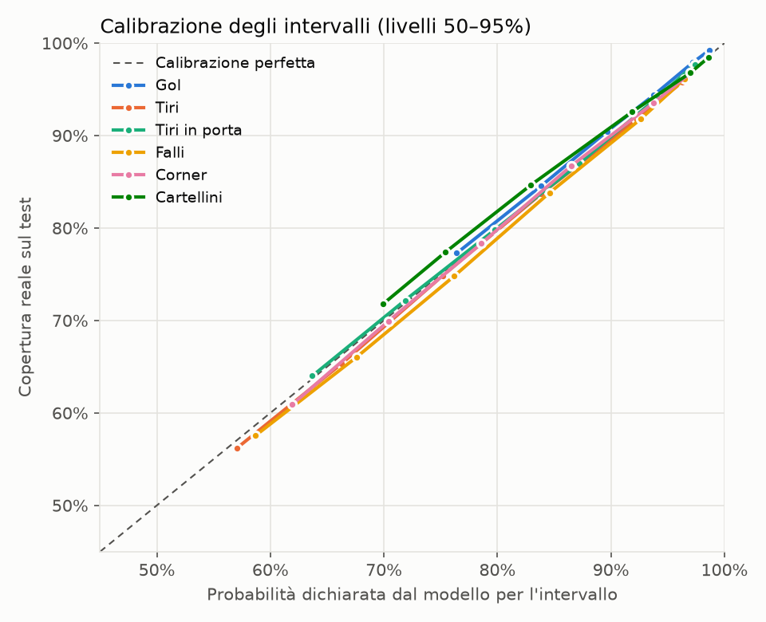

# Football Stats Forecast

Previsione delle statistiche di una partita di calcio (gol, tiri, tiri in porta, falli, corner, cartellini) **con un intervallo di previsione**, non solo con un numero.

```
$ python -m footstats predict Inter Roma

Inter – Roma   (range al 80%, dati fino al 2026-11-22)

  Inter
    Gol            atteso   2.0    range  0–4    (probabilità 95%)
    Tiri           atteso  17.4    range 11–25   (probabilità 82%)
    Tiri in porta  atteso   6.2    range  3–10   (probabilità 87%)
    Falli          atteso  10.1    range  6–14   (probabilità 85%)
    Corner         atteso   5.7    range  2–10   (probabilità 89%)
    Cartellini     atteso   1.6    range  0–3    (probabilità 92%)
  ...
```

Copre Serie A, Premier League, La Liga, Bundesliga e Ligue 1, su circa 22.000 partite dal 2014-15.

## Perché un range

Un singolo numero ("l'Inter farà 17 tiri") nasconde quanto è incerta la previsione. Il modello invece stima una **distribuzione di probabilità** per ogni statistica e ne ricava un intervallo: "con l'80% di probabilità l'Inter farà tra 11 e 25 tiri".

Un intervallo è utile solo se è **onesto**: se dico 80%, il valore vero deve cadere dentro circa 8 volte su 10. È la proprietà che ho verificato per prima (vedi sotto).

## Risultati

Valutazione su **2024-25 e 2025-26**, due stagioni mai usate né per l'addestramento né per scegliere il modello (circa 7.000 previsioni squadra-partita).

### Gli intervalli sono calibrati

| Statistica | Ampiezza media del range 80% | Probabilità dichiarata | Copertura reale |
|---|---|---|---|
| Gol | 2,9 | 93,8% | 94,4% |
| Tiri | 11,2 | 83,9% | 83,7% |
| Tiri in porta | 5,5 | 87,2% | 87,0% |
| Falli | 8,8 | 84,6% | 83,8% |
| Corner | 6,6 | 86,5% | 86,8% |
| Cartellini | 3,7 | 91,8% | 92,5% |

Le statistiche sono numeri interi, quindi un intervallo non può contenere *esattamente* l'80%: per i tiri dell'Inter, "tra 11 e 25" vale l'82% e "tra 12 e 24" il 75%. Si sceglie sempre l'intervallo che contiene almeno l'80%, e la colonna *Probabilità dichiarata* riporta quanto contiene davvero. La copertura reale coincide con quella dichiarata, entro 2 punti percentuali, per tutte le statistiche e a tutti i livelli dal 50% al 95%:



Un esempio partita per partita: i tiri dell'Inter nella Serie A 2025-26, che il modello non aveva mai visto.


### La calibrazione viene dal metodo, la precisione dal modello

Anche le baseline più semplici producono range calibrati, entro 2 punti a tutti i livelli. Il motivo è che la dispersione *k* viene stimata sulla validazione: un modello che sbaglia di più il valore atteso ottiene un *k* più basso, quindi range più larghi (per i tiri *k* = 11 con la media del campionato, 22 con il modello scelto). La calibrazione è quindi una proprietà del **metodo**. Il contributo del **modello** è un'altra: range **più stretti** a parità di affidabilità.

Ampiezza media del range all'80% sul test:

| Statistica | Media del campionato | Media mobile | Modello scelto | Più stretto vs media mobile |
|---|---|---|---|---|
| Gol | 3,0 | 3,0 | 2,9 | 2,8% |
| Tiri | 13,0 | 12,0 | 11,2 | 7,0% |
| Tiri in porta | 6,1 | 5,8 | 5,5 | 4,4% |
| Falli | 9,5 | 8,9 | 8,8 | 1,7% |
| Corner | 7,0 | 6,8 | 6,6 | 3,0% |
| Cartellini | 3,9 | 3,8 | 3,7 | 1,6% |

### Il valore atteso batte le baseline

Errore medio assoluto (MAE) sul test, più basso è meglio:

| Statistica | Media del campionato | Media mobile | GLM Poisson | Gradient Boosting | Ensemble | Modello scelto | Miglioramento vs media mobile |
|---|---|---|---|---|---|---|---|
| Gol | 0,986 | 0,932 | 0,903 | 0,904 | **0,902** | Ensemble | 3,2% |
| Tiri | 4,136 | 3,768 | **3,539** | 3,565 | 3,544 | Ensemble | 5,9% |
| Tiri in porta | 1,930 | 1,796 | 1,730 | 1,735 | **1,729** | Ensemble | 3,7% |
| Falli | 3,056 | 2,851 | 2,819 | 2,809 | **2,807** | Ensemble | 1,5% |
| Corner | 2,243 | 2,147 | 2,082 | 2,084 | **2,080** | GLM Poisson | 3,1% |
| Cartellini | 1,132 | 1,121 | 1,109 | **1,103** | 1,104 | Gradient Boosting | 1,6% |

La *media mobile* è ciò che farebbe chiunque: metà la media della squadra in attacco, metà la media concessa dall'avversario. I miglioramenti sono reali ma moderati, ed è un risultato atteso: una parte grande della variabilità di una singola partita è rumore che nessun modello può prevedere con questi dati. Il GLM di Poisson, molto più semplice, è alla pari con il gradient boosting. Il *modello scelto* è quello migliore sulla stagione di validazione, non sul test: per questo a volte non coincide con il grassetto.

Dettagli completi in [`reports/results.md`](reports/results.md) e [`reports/results.json`](reports/results.json).

## Come funziona

**1. Dati.** Statistiche di fine partita da [football-data.co.uk](https://www.football-data.co.uk/), con il mirror pubblico [datasets/football-datasets](https://github.com/datasets/football-datasets) (licenza ODC-PDDL) come alternativa. Ogni partita diventa due righe, una per squadra.

**2. Feature (solo informazioni pre-partita).** Per la squadra e per l'avversario: medie esponenziali delle ultime partite (forma recente e livello di fondo), medie solo in casa o solo in trasferta, quanto produce l'attacco e quanto concede la difesa. Le stesse medie esistono anche **aggiustate per la forza degli avversari affrontati**: 15 tiri contro la difesa migliore del campionato valgono più di 15 tiri contro la peggiore, quindi ogni partita passata conta come rapporto tra quanto la squadra ha prodotto e quanto quell'avversario concedeva di solito. Infine la media del campionato fino al giorno prima, in cui le partite perdono metà del peso ogni anno, così da seguire i cambiamenti del campionato (per esempio arbitraggi più o meno severi). Una squadra che torna dalla serie inferiore riparte dalla media del campionato invece che dai dati di anni prima. Il ritorno si riconosce da una pausa di oltre 300 giorni: uno stop lungo ma interno al campionato, come la Ligue 1 interrotta per il Covid nel 2020 (fino a 194 giorni), non cancella la storia delle squadre.

> Il rischio principale in questi progetti è il *data leakage*: usare senza accorgersene informazioni della partita stessa o di partite future. Un test automatico ([`tests/test_features.py`](tests/test_features.py)) modifica il risultato di una partita e verifica che le sue feature non cambino. Ho controllato che il test fallisca davvero se si introduce un leak.

**3. Valore atteso.** Cinque modelli a confronto: media del campionato, media mobile, regressione di Poisson (GLM), gradient boosting con perdita di Poisson e un **ensemble** che fa la media delle previsioni di GLM e gradient boosting. I due modelli sbagliano in modo diverso (il GLM è più stabile, il boosting coglie le interazioni), quindi la loro media è spesso migliore di ciascuno dei due. Per ogni statistica si sceglie il modello con il miglior *log-score* sulla stagione di validazione.

**4. Distribuzione e range.** Attorno al valore atteso μ si usa una **Binomiale Negativa**, con varianza μ + μ²/k. Il parametro di dispersione *k* è stimato per ogni statistica, per massima verosimiglianza, su dati non usati in training. Se i dati non mostrano sovra-dispersione si ricade nella Poisson: succede per gol e cartellini, mentre tiri e corner sono chiaramente più variabili.

**5. Protocollo temporale.**

| Fase | Stagioni | Uso |
|---|---|---|
| Training | 2014-15 … 2022-23 | addestramento dei candidati |
| Validazione | 2023-24 | scelta del modello e stima di *k* |
| Test | 2024-25, 2025-26 | misura finale, una sola volta |
| Modello finale | tutte | usato da `predict` |

## Come ho migliorato il modello (senza guardare il test)

Ogni idea è stata provata solo su stagioni di validazione. Per ciascuna stagione tra 2021-22, 2022-23 e 2023-24 il modello è addestrato sulle stagioni precedenti e valutato su quella. Le stagioni di test sono state usate una sola volta, alla fine, per misurare il risultato.

| Idea | Effetto in validazione (MAE rispetto al GLM precedente) | Decisione |
|---|---|---|
| Medie aggiustate per la forza degli avversari | tiri −0,5%, piccoli miglioramenti quasi ovunque | tenuta |
| In più, media del campionato con memoria di un anno (prima: tutta la storia dal 2014) | tiri −0,6%, falli −0,3% | tenuta |
| Ensemble GLM + gradient boosting (con le medie aggiustate) | tiri −0,8%, falli −0,7%, cartellini −0,4% | tenuto |
| Griglie di iperparametri più ampie | la validazione sceglieva sempre i valori al bordo della griglia | tenute |
| Memorie diverse per le medie (2, 20 o 30 partite) | effetti sotto lo 0,15% | scartata |
| Giorni di riposo tra una partita e l'altra | nessun effetto | scartata |
| Più peso alle stagioni recenti in addestramento | migliora i falli, peggiora gol e tiri in porta | scartata |

Sul test, rispetto alla versione precedente: log-score migliore per tutte e sei le statistiche, MAE dei tiri −0,9%, dei falli −0,4% e dei gol −0,2%, con corner, cartellini e tiri in porta praticamente invariati. La calibrazione resta entro 2 punti. Sono guadagni piccoli, coerenti con l'idea che il limite principale sia l'informazione disponibile (formazioni, infortuni), non il modello.

## Esperimento: dalle squadre ai giocatori

Il modello guarda le squadre, ma in campo vanno i giocatori. Per misurare quanto conti sapere **chi gioca**, ho usato i dati aperti Wyscout della stagione 2017-18: 5 campionati, con formazioni ed eventi di ogni giocatore, licenza CC BY 4.0 ([Pappalardo et al., 2019](https://figshare.com/collections/Soccer_match_event_dataset/4415000)). Il modello è lo stesso, addestrato sul girone d'andata e valutato sul ritorno, con e senza il rendimento dei titolari (la loro media ogni 90 minuti nelle partite precedenti). Dettagli in [`reports/player_level.md`](reports/player_level.md), codice in [`experiments/player_level.py`](experiments/player_level.py).

- **Nel complesso le feature sui giocatori non migliorano le previsioni**: tutte le differenze stanno entro ±0,6% e dentro il margine del caso.
- **Il segnale però c'è dove ci si aspetta.** Quando una squadra cambia almeno 4 titolari (31% delle partite), conoscere la formazione riduce l'errore sui tiri dell'1,1%, e lo scostamento dell'undici dal solito è correlato con l'errore del modello di squadra (+0,08 per i tiri). Per falli e cartellini, invece, chi gioca conta poco.
- **Con una sola stagione il segnale è troppo debole per essere sfruttato**: servirebbero più stagioni di dati per giocatore.

## Limiti, onestamente

- **I range sono larghi, e devono esserlo.** Per i tiri dell'Inter contro la Roma un range "stretto" come 15–19 avrebbe solo il **35%** di probabilità. Restringere l'intervallo senza informazioni nuove renderebbe il modello sicuro di sé, non più preciso.
- **Per gol e cartellini il range serve poco**: con medie intorno a 1-2, "da 0 a 3" copre quasi tutto. Il modello dà il meglio su tiri, falli e corner.
- **Mancano informazioni importanti**: formazioni, infortuni, arbitro (non disponibile per tutti i campionati), dati posizionali, xG. Sono le aggiunte che più probabilmente migliorerebbero le previsioni.
- **Il modello non si riaddestra durante la stagione di test**: in uso reale andrebbe aggiornato ogni giornata (walk-forward), il che darebbe risultati leggermente migliori di quelli riportati.

## Prossimi passi

- Aggiornamento walk-forward giornata per giornata.
- Feature sulle formazioni con più stagioni di dati per giocatore (vedi l'esperimento sopra), e sull'arbitro dove disponibile.
- Modello gerarchico (effetti squadra con *shrinkage*) per gestire meglio le neopromosse.
- Distribuzione congiunta delle due squadre (oggi casa e ospite sono previste separatamente).
- Una piccola dashboard web.

## Storia del progetto

Progetto di aprile 2026. Iniziato a tempo perso, come web-app per le scommesse che usava lo scraping, abbandonata però a giugno. A novembre 2026 l'ho ripreso e l'ho trasformato in questa versione pubblica: previsione delle statistiche con dati scaricabili liberamente.

## Uso

Richiede Python 3.10 o successivo.

```bash
pip install -r requirements.txt

python -m footstats download          # scarica i dati in data/raw/ (circa 1 minuto)
python -m footstats train             # addestra, valuta e scrive reports/ (alcuni minuti)
python -m footstats predict Inter Roma
python -m footstats predict Arsenal Chelsea --league premier-league --level 0.5

python -m pytest                      # test
python experiments/player_level.py    # esperimento sui giocatori (scarica circa 80 MB di dati Wyscout)
```

I nomi delle squadre sono quelli di football-data.co.uk ("Inter", "Milan", "Juventus"…); quelli simili vengono riconosciuti automaticamente. `predict` usa le partite più recenti disponibili: per la stagione in corso `download` prova prima la fonte originale, che viene aggiornata durante la stagione.

## Struttura

```
footstats/
  config.py     campionati, statistiche, split temporali
  data.py       download e pulizia dei dati
  features.py   feature pre-partita (senza leakage)
  models.py     modelli per la media, Binomiale Negativa, intervalli
  train.py      selezione, valutazione sul test, modello finale
  report.py     tabelle e grafici in reports/
  predict.py    previsione di una partita
tests/          test su leakage, dispersione e copertura degli intervalli
reports/        risultati e grafici della valutazione
experiments/    esperimento con le formazioni (dati aperti Wyscout 2017-18)
```
